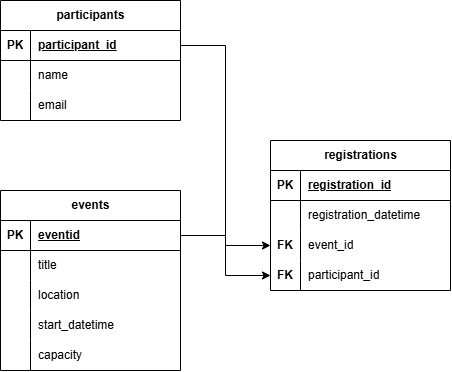

# COMP-4633-Assignment-1

## API URL

The general API url on a successful deploy is http://[VM_IP_ADDR]:5000/api/v1

## Setup

### Initial Configuration
Start a fresh VM off of ubuntu-latest for something like google cloud.

If you don't have sudoer rights, you should grant yourself admin/sudo rights in your vm instance.

Run the following command to install needed dependencies, then clone the repository and move into it:

```bash
sudo apt update
sudo apt install -y python3-pip python3-venv mysql-server git
sudo apt install tmux
sudo apt install nano
git clone <repo link>
cd COMP-4633-Assignment-1
```

### Database Configuration and Initialization
A visualization of the tables in an entity relation diagram:



Assuming you are in directory: ~/COMP-4633-Assignment-1, do the following:

Next, to run the mySQL VM in the background, do the following to initialize your schema and run your seed script in the background:

```bash
sudo systemctl start mysql

sudo mysql < schema.sql
sudo mysql < seed.sql

```

This is not a best practice, but for a quick start guide you can simply run this to generate a new user that will work with your .env file.

```bash
sudo mysql -e "CREATE USER 'api_user'@'localhost' IDENTIFIED BY 'your_secure_password';"
sudo mysql -e "GRANT ALL PRIVILEGES ON campus_events.* TO 'api_user'@'localhost';"
sudo mysql -e "FLUSH PRIVILEGES;"
```
Afterwards, to create the respective .env file needed to use that database, run the following command:
```Bash
cp .env.example .env
nano .env
```

Fill your .env information out with your actual database account to connect your application to your database. If using the existing bad practice login, the default .env.example will work.

The database address is not in the source. Put it in `.env`, which is gitignored:
### Environment setup & Execution

Under the same assumption of you being in ~/COMP-4633-Assignment-1
If you want persistence, enter the following before running the below commands:
```bash 
tmux
```

To set up your environment, first run the following bash commands:
``` bash
python3 -m venv .venv
source .venv/bin/activate
python -m pip install -r requirements.txt
python3 app.py
```
To return from tmux enter the following commands one after the other
```terminal
ctrl+b
d
``` 
### Testing 
From the ~/COMP-4633-Assignment-1 Directory, run `pytest` in the terminal after the above setup (database not needed for the isolated pytest test cases!)

To run the shell script, assuming your app.py is running and everything is good:

``` bash
chmod +x test_integration.sh
./test_integration.sh
```
## Commands

There are 9 commands tied to different API calls.  The calls below are done with curl to show an exmaple of executing them.
### 1. Check API health
/api returns a health call. it can be invoked as follows (omit curl if you're using postman, this is doing it in the linux terminal):
```bash
curl http://[your_vm_ip_address]:5000/api
```
### List events
/api/v1/events supports a get call, to list all valid events from python call the following (if using curl):
```bash
curl -X GET http://[your_vm_ip]:5000/api/v1/events -H "Content-Type: application/json"
```
### List a specified event
Called via /api/v1/events/<event_id>, with the example being:
```bash
curl -X GET http://[your_vm_ip]:5000/api/v1/events/1 -H "Content-Type: application/json"
```
### Add a new event
```bash
curl -X POST http://[your_vm_ip]:5000/api/v1/events -H "Content-Type: application/json" -d '{"title": "Senior Social", "location":"Lincoln park", "start_datetime":"2027-01-12 16:00:00", "capacity": 12}'
```
### Modify an event
This requires the specific eent path in the url, and for you to change the json structure with a valid update (e.g.,  time has to be in the future, can't modify an event to lower its capacity below the current rgistration), with a path of /api/v1/events/<int:event_id>
```bash
curl -X PATCH http://[your_vm_ip]:5000/api/v1/events/1 -H "Content-Type: application/json" -d '{"capacity": 20}'
```
### Delete an event
This requires there to be no existing registrations for the given event, and a valid event ID.
```bash
curl -X DELETE http://[your_vm_ip]:5000/api/v1/events/1
```
### List registrations for a given event
This requires you to know the event ID and to provide it as a query parameter in the path /api/v1/registrations/?event_id=<your_event_id>
```bash
curl -X GET "http://[YOUR_VM_IP]:5000/api/v1/registrations/?event_id=1" -H "Content-Type: application/json"
```
### Register A Participant for an Event
This requires you to structure a json payload in the structure of '{"event_id": <event_id>, "participant_id": <participant_id>}
```bash
curl -X POST http://[your_vm_ip]:5000/api/v1/registrations \
-H "Content-Type: application/json" \
-d '{"event_id": 1, "participant_id": 4}'
```
### Cancel an existing registration
```bash
curl -X DELETE http://[your_vm_ip]:5000/api/v1/registrations/1   
```
### List an existing registration
This takes your input as a query parameter.
```bash
curl -X GET "http://[your_vm_ip]:5000/api/v1/registrations/?event_id=1"   
```
## Known Limitations
### Authentication:
Outside of basic DB authentication, the API does not actually authenticate users to validate if they should be allowed to call the API.

### Participant creation:
The DB does not currently allow users to create new participants via an API endpoint. All participants are fixed.

### DB write issues:
The database currently has no locking for resolving concurrency bugs or managling writes when it is under heavy load. This means it is possible for there to be errors from a heavy write load to the DB.

### Lazy 'not found' DB validation:
A lot of database calls will try a write/read and use the result to determine if there was an error or not (modifying something that doesn't exist will tell us that we dealt with 0 rows, letting us know the call was to an invalid id)